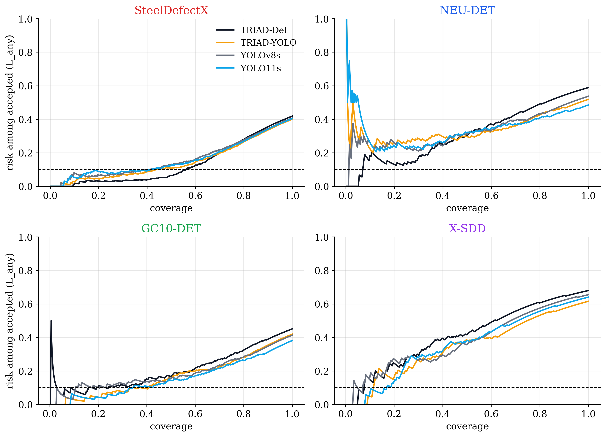
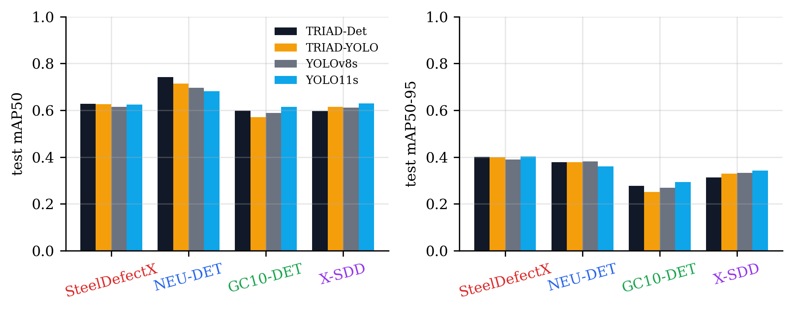
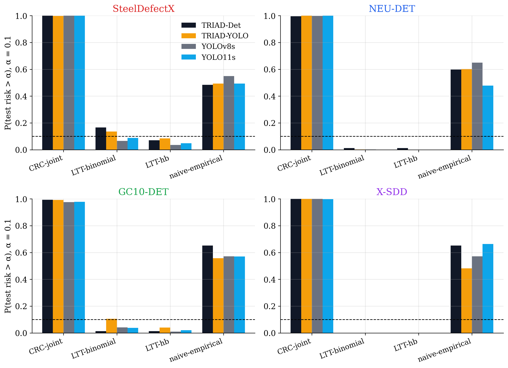
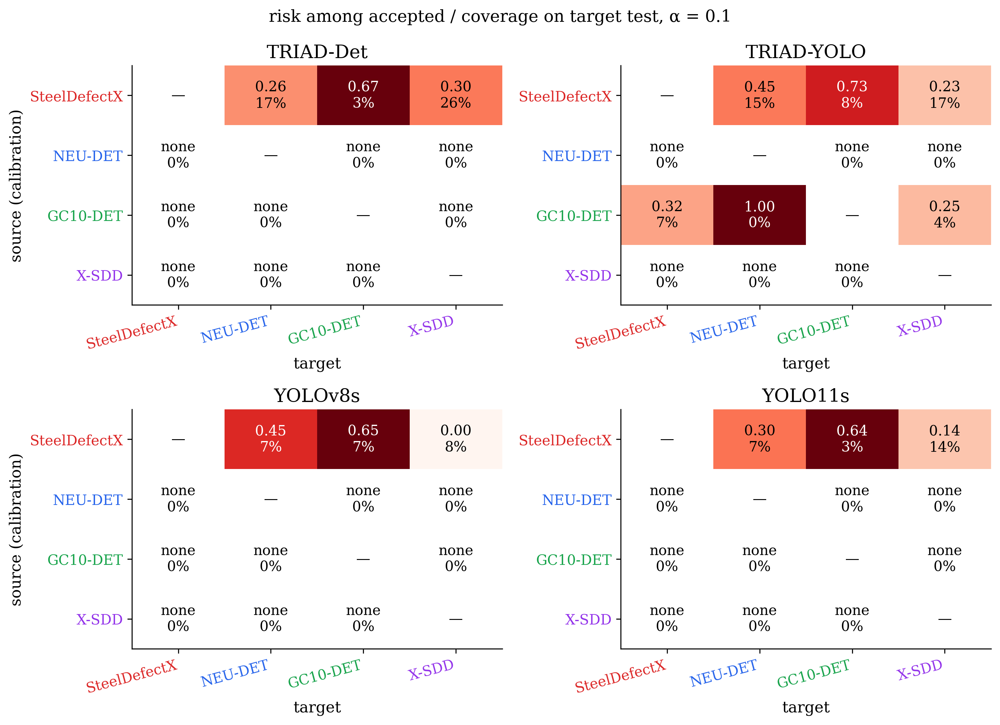
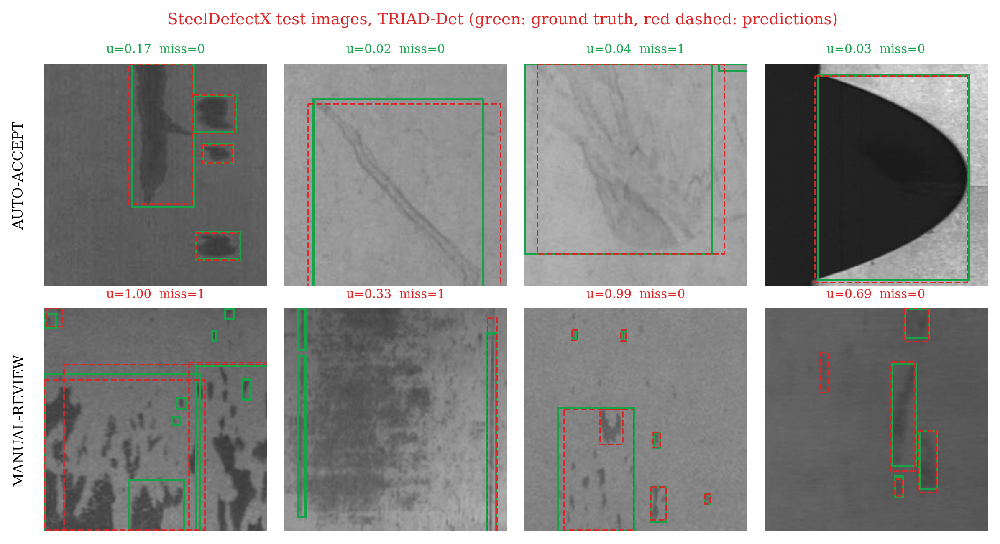

# TRIAD-Det

**Risk-controlled selective prediction for steel surface defect detection.**

Automated inspection needs to know when it can be trusted. TRIAD-Det routes every image to one of two outcomes:

- **AUTO-ACCEPT:** the detector's output is used without review.
- **MANUAL-REVIEW:** a person inspects the image.

The acceptance threshold is calibrated so that the miss rate among accepted images is at most α, with probability at least 1 − δ. If no threshold can be certified, every image goes to manual review.

The study covers four detectors on four datasets. It includes TRIAD-Det, a new anchor-free detector with a census branch that estimates how many defects an image should contain.

| | |
|---|---|
| **Detectors** | TRIAD-Det, TRIAD-YOLO, YOLOv8s, YOLO11s |
| **Datasets** | SteelDefectX, NEU-DET, GC10-DET, X-SDD |
| **Calibration** | Learn-then-Test with fixed-sequence testing |
| **Headline setting** | α = 0.10, δ = 0.10, IoU 0.5 |

## Contents

- [Key results](#key-results)
  - [Risk control at α = 0.10, δ = 0.10](#risk-control-at-α--010-δ--010)
  - [Detection](#detection-test-map50--map50-95)
  - [Does the guarantee hold?](#does-the-guarantee-hold)
  - [Under a change of dataset](#under-a-change-of-dataset)
  - [Example decisions](#example-decisions)
  - [Does the census branch help?](#does-the-census-branch-help)
- [Method](#method)
- [Repository layout](#repository-layout)
- [Datasets](#datasets)
- [Installation](#installation)
- [Usage](#usage)
- [Results and outputs](#results-and-outputs)
- [Limitations](#limitations)
- [Reproducibility status](#reproducibility-status)
- [License](#license)

## Key results

All numbers are on held-out test splits. The first two tables come from [`results.csv`](TRIAD_det/results.csv); the later ones name their source file.

### Risk control at α = 0.10, δ = 0.10

"Coverage" is the share of test images auto-accepted. "Risk" is the share of accepted images with at least one missed defect, with its 95% Clopper–Pearson interval. Only 5 of the 16 model × dataset combinations were certified. The other 11 send every image to manual review, which is the intended safe outcome.

| Dataset | Model | Certified | Coverage | Risk among accepted (95% CI) |
|---|---|:---:|---:|---|
| SteelDefectX | **TRIAD-Det** | Yes | **49.8%** | 6.4% (4.5–8.8) |
| SteelDefectX | TRIAD-YOLO | Yes | 30.9% | 6.9% (4.5–10.1) |
| SteelDefectX | YOLO11s | Yes | 23.8% | 7.8% (4.9–11.7) |
| SteelDefectX | YOLOv8s | Yes | 8.2% | 4.3% (1.2–10.6) |
| GC10-DET | TRIAD-YOLO | Yes | 41.0% | 10.6% (6.0–16.8) |
| GC10-DET | TRIAD-Det, YOLOv8s, YOLO11s | No | 0% | n/a |
| NEU-DET | all four | No | 0% | n/a |
| X-SDD | all four | No | 0% | n/a |

The guarantee is a probability over calibration draws, so one test split can land slightly above α. The GC10-DET row at 10.6% is an example, and its interval contains 10%.

<p align="center">
  
</p>

*Risk among accepted images (`L_any`) against coverage on the test split, per dataset. The dashed line is α = 0.10. A curve that stays below it over a wider range of coverage means the uncertainty score ranks risky images better; TRIAD-Det does this on SteelDefectX.*

### Detection (test mAP50 / mAP50-95)

| Model | SteelDefectX | NEU-DET | GC10-DET | X-SDD |
|---|---|---|---|---|
| TRIAD-Det | **0.629** / 0.401 | **0.742** / 0.379 | 0.598 / 0.278 | 0.596 / 0.314 |
| TRIAD-YOLO | 0.626 / 0.400 | 0.715 / 0.379 | 0.570 / 0.250 | 0.615 / 0.330 |
| YOLOv8s | 0.615 / 0.390 | 0.697 / **0.382** | 0.589 / 0.268 | 0.612 / 0.333 |
| YOLO11s | 0.624 / **0.403** | 0.681 / 0.360 | **0.615** / **0.293** | **0.629** / **0.342** |

No single detector wins everywhere. TRIAD-Det leads mAP50 on SteelDefectX and NEU-DET, and YOLO11s leads on GC10-DET and X-SDD.

<p align="center">
  
</p>

### Does the guarantee hold?

Violation rates at α = δ = 0.10 for `L_any`, over all 16 model × dataset combinations and 500 random calib/test re-splits. Source: `in_domain_validity.csv`.

| Method | Mean violation rate | Highest |
|---|---:|---:|
| LTT, Hoeffding–Bentkus | 2.1% | 8.4% |
| LTT, exact binomial (headline) | 4.2% | 16.6% |
| Naive empirical threshold | 56.7% | 66.4% |
| Conformal Risk Control (joint risk) | 99.6% | 100% |

These rates compare the empirical risk on a finite test half with α, so they include sampling noise. `validity_decomposition.csv` separates the two by measuring the true risk on a known population. Over the same 16 combinations, the highest true violation rate is 8.2% for the binomial test and 2.6% for Hoeffding–Bentkus, both below δ. Conformal Risk Control bounds the joint risk, not the risk among accepted images, so a high rate here is expected.

<p align="center">
  
</p>

*Share of the 500 re-splits in which the test risk exceeded α = 0.10 (dashed line), per method. LTT bars are missing or near zero on NEU-DET and X-SDD because it certified almost nothing there, so there was little to violate.*

### Under a change of dataset

All 48 cross-dataset cases (four models × 12 directed pairs) at α = 0.10, with class-agnostic matching. Source: `cross_domain_selective.csv`.

| Protocol | Certified | Exceeded α on target test | Mean coverage |
|---|---:|---:|---:|
| LTT threshold calibrated on the source | 15 / 48 | 14 | 3.0% |
| Naive threshold calibrated on the source | 45 / 48 | 38 | 7.9% |
| LTT threshold recalibrated on the target | 2 / 48 | 0 | 0.1% |

A threshold calibrated on one dataset should not be reused on another: 14 of the 15 certified transfers exceeded α on the target. Recalibrating on the target is safe, but it accepts almost nothing.

<p align="center">
  
</p>

*Thresholds calibrated on the source (rows) and applied to the target (columns), at α = 0.10. Each cell shows risk among accepted images over coverage; "none" means no threshold was certified.*

**Target adaptation.** Only part of the planned grid has been run: TRIAD-Det, 100 target images, one draw, six fine-tuning transfers and three from-scratch controls. No run was certified at α ≤ 0.20. At α = 0.30, 4 of 18 cases were certified, and none exceeded α on test. Source: `adaptation/target_adaptation.csv`.

### Example decisions

<p align="center">
  
</p>

*TRIAD-Det on SteelDefectX test images. Green boxes are ground truth and red dashed boxes are predictions; `u` is the uncertainty score and `miss` marks an image with at least one missed defect. The top row was auto-accepted and the bottom row sent to review. One accepted image still has a miss, which is what a risk of up to α allows.*

The same figure for the other datasets: [NEU-DET](TRIAD_det/TRIAD_Det_Risk_Control/results/figures/full/fig12_examples_NEU-DET.png), [GC10-DET](TRIAD_det/TRIAD_Det_Risk_Control/results/figures/full/fig12_examples_GC10-DET.png), [X-SDD](TRIAD_det/TRIAD_Det_Risk_Control/results/figures/full/fig12_examples_X-SDD.png).

### Does the census branch help?

Test AURC of the `stats` score for TRIAD-Det, without and with the four census statistics. Lower is better. Source: `census_ablation_stats_comparison.csv`.

| Dataset | Without census | With census | Difference (95% bootstrap CI) |
|---|---:|---:|---|
| SteelDefectX | 0.1362 | 0.1343 | −0.0019 (−0.0029 to −0.0009) |
| NEU-DET | 0.3205 | 0.3160 | −0.0045 (−0.0233 to 0.0131) |
| GC10-DET | 0.2112 | 0.2123 | +0.0012 (−0.0113 to 0.0130) |
| X-SDD | 0.4100 | 0.4138 | +0.0035 (−0.0094 to 0.0178) |

The gain is small and its interval excludes zero only on SteelDefectX. The census branch itself is fairly accurate (count MAE 0.51–1.25, presence micro-F1 0.88–0.99), but most of its information is already in the detection statistics.

## Method

### TRIAD-Det detector

TRIAD-Det (Triple-branch Risk-Aware Inspection Detector) is a single-stage, anchor-free detector in plain PyTorch. It shares no building blocks with the YOLO family.

| Part | Design |
|---|---|
| Backbone | ConvNeXt-Tiny from timm, ImageNet-pretrained |
| Neck | Bidirectional fusion: top-down FPN pass, then bottom-up pass, with GroupNorm |
| Detection branch | Per-location class logits and box distances |
| Quality branch | Per-location IoU-aware localisation quality |
| Census branch | Image-level defect count (Poisson rate) and class presence |
| Training (v2) | ATSS assignment, quality focal loss, EMA weights, mosaic augmentation |

The census branch gives a signal that needs no ground truth: a gap between the expected number of defects and the number of confident boxes suggests a defect may have been missed. The measured benefit is small; see [Does the census branch help?](#does-the-census-branch-help)

### Compared models

| | TRIAD-Det | TRIAD-YOLO | YOLOv8s | YOLO11s |
|---|---|---|---|---|
| Implementation | Plain PyTorch | Ultralytics YAML hybrid | Ultralytics | Ultralytics |
| Backbone | ConvNeXt-Tiny | YOLOv8 C2f + YOLO11 C3k2/C2PSA | CSPDarknet-C2f | C3k2 + C2PSA |
| Head | Anchor-free, three branches | YOLO Detect | YOLO Detect | YOLO Detect |
| Parameters | 33.6 M | 9.84 M | ~11 M | ~9 M |

### Risk control

1. **Loss.** `L_any` is 1 if any ground-truth box is missed at IoU 0.5 with the correct class. `L_fraction` is the share of boxes missed. Cross-dataset matching is class-agnostic.
2. **Uncertainty score.** Candidates are `conf`, `weakest`, `grey`, `stats` (a logistic model fitted on val), `census` (TRIAD-Det only) and `disagree` (between detectors). The score with the lowest AURC on **val** is reported.
3. **Calibration.** Learn-then-Test fixed-sequence testing runs on **calib**, with the threshold order taken from val. P-values are exact binomial for `L_any` and Hoeffding–Bentkus for `L_fraction`.
4. **Decision.** An image is auto-accepted when its uncertainty is at or below the calibrated threshold. The guarantee is:

   ```text
   P_calib( R(λ̂) ≤ α ) ≥ 1 − δ,   where R(λ) = E[ L | u ≤ λ ]
   ```

5. **Evaluation.** The **test** split reports coverage, manual-review rate and risk among accepted images. Validity is checked over 500 random calib/test re-splits. Score comparisons use a paired bootstrap with Holm correction.

Baselines are Conformal Risk Control on the joint risk, a naive empirical threshold, and a fixed confidence of 0.5.

## Repository layout

```text
TRIAD-Det/
├── GC10-DET/  NEU-DET/              Datasets: IMAGES/<class>/, ANNOTATIONS/*.xml
├── SteelDefectX-DET/  X-SDD-DET/    Datasets built for detection, same layout
└── TRIAD_det/
    ├── run_all.py                   Base pipeline entry point
    ├── results.csv                  One row per model × dataset
    ├── requirements.txt             Minimum package versions
    ├── requirements-lock.txt        Exact versions used for the results
    ├── triad/                       Data, splits, YOLO-family detector, evaluation, export
    ├── tools/                       Study runner, dataset builder, figure and packaging scripts
    ├── tests/                       Core unit tests
    ├── OUTPUT/batches/              Annotated test-image batches per model and dataset
    └── TRIAD_Det_Risk_Control/
        ├── config/experiment_config.yaml
        ├── src/                     Calibration, losses, scores, statistics
        │   └── triad_det_model/     TRIAD-Det model and training
        ├── experiments/             In-domain, cross-domain, ablation and figure scripts
        ├── tests/                   Calibration validity tests
        ├── reports/                 Literature review
        ├── results/                 Predictions, tables, figures, logs
        └── EXECUTION_LOG.md         Dated log of the study's main steps
```

## Datasets

| Dataset | Images used | Classes | Test images | Box source |
|---|---:|---:|---:|---|
| SteelDefectX | 7,193 | 25 | 1,128 | Official pixel masks converted to boxes |
| NEU-DET | 1,800 | 6 | 270 | Original XML |
| GC10-DET | 2,292 | 10 | 346 | Original XML |
| X-SDD | 1,360 | 7 | 203 | Matched SteelDefectX copies |

**Sources for the built datasets**

- SteelDefectX: Hugging Face `Zhaosxian/SteelDefectX` (CC-BY-4.0)
- X-SDD: `github.com/Fighter20092392/X-SDD-A-New-benchmark` (Apache-2.0)

**Splits**

- Train / val / calib / test is 60 / 10 / 15 / 15%, with seed 42, stratified by class.
- Duplicates and cross-dataset copies always stay in one split. SteelDefectX contains copies from NEU-DET and X-SDD, and crops from GC10-DET.
- NEU-DET and GC10-DET are split first and then frozen.
- 580 of the 7,773 SteelDefectX images are excluded because they link anchor images in different splits, which would cause leakage.

## Installation

Tested on Windows 11 with an NVIDIA RTX 3060 12 GB and Python 3.10.11. Key packages are torch 2.11.0+cu128, ultralytics 8.4.202 and timm 1.0.31. Training requires CUDA. Linux and macOS are untested.

```powershell
git clone https://github.com/RiteshKumar2e/TRIAD-Det.git
cd TRIAD-Det\TRIAD_det

py -3.10 -m venv .venv
.venv\Scripts\python -m pip install --upgrade pip
.venv\Scripts\pip install torch==2.11.0 torchvision==0.26.0 --index-url https://download.pytorch.org/whl/cu128
.venv\Scripts\pip install -r requirements-lock.txt --extra-index-url https://download.pytorch.org/whl/cu128
```

Check the install:

```powershell
.venv\Scripts\python -c "import torch; print(torch.__version__, torch.cuda.is_available())"
.venv\Scripts\python -m pytest tests TRIAD_Det_Risk_Control/tests -q
```

The first command must print `True`, and the tests should report 15 passed (about 2–3 minutes; the calibration validity tests take most of it). If the first command prints `False`, the CPU-only torch was installed: uninstall `torch` and `torchvision`, then repeat the install commands. Pretrained weights download on first use.

## Usage

Run these from `TRIAD_det/`. Read [Reproducibility status](#reproducibility-status) first, because some commands need files that are not in this repository.

**Whole study** (unattended, skips finished jobs):

```powershell
.venv\Scripts\python tools/run_everything.py
```

**Individual steps:**

```powershell
# Train a YOLO-family model: TRIAD-YOLO | YOLOv8s | YOLO11s
.venv\Scripts\python tools/train_one.py --dataset GC10-DET --model YOLOv8s

cd TRIAD_Det_Risk_Control

# Train TRIAD-Det, then write its predictions
..\.venv\Scripts\python -m src.triad_det_model.train --dataset NEU-DET --train-only
..\.venv\Scripts\python -m src.triad_det_model.train --dataset NEU-DET --predict-only

# Risk-control experiments
..\.venv\Scripts\python experiments/predict_yolo.py
..\.venv\Scripts\python experiments/in_domain.py
..\.venv\Scripts\python experiments/cross_domain.py
..\.venv\Scripts\python experiments/recalibration.py
..\.venv\Scripts\python experiments/ablation.py
..\.venv\Scripts\python experiments/figures.py
```

**Further analyses** in `TRIAD_Det_Risk_Control/experiments/`:

| Script | Question |
|---|---|
| `census_ablation.py` | Does the census branch improve the uncertainty score? |
| `validity_check.py` | Is a re-split violation a real guarantee failure or finite-test noise? |
| `target_adaptation.py` | Can a small labelled target set restore auto-acceptance on a new dataset? |

`census_ablation.py` defaults to `--variant selected`, while `validity_check.py` defaults to `full`. Pass `--variant full` to the first to match the tables above.

**Rebuild the derived datasets** from fresh downloads:

```powershell
.venv\Scripts\python tools/build_detection_datasets.py --sdx <SteelDefectX download> --xsdd <X-SDD repo>/X-SDD/datas --out ..
```

## Results and outputs

Paths are under `TRIAD_det/`. Everything listed here is in the repository, so you can browse the tables and figures without installing anything or having a GPU.

| Location | Contents |
|---|---|
| `results.csv` | Training, detection and risk-control summary |
| `TRIAD_Det_Risk_Control/results/tables/full/` | In-domain, cross-domain, recalibration, ablation, census and validity tables |
| `TRIAD_Det_Risk_Control/results/tables/adaptation/` | Target adaptation results |
| `TRIAD_Det_Risk_Control/results/figures/full/` | Figures 1–12 as 300-DPI PNG and PDF (index below) |
| `TRIAD_Det_Risk_Control/results/predictions/` | AUTO-ACCEPT / MANUAL-REVIEW decisions and adaptation predictions |
| `OUTPUT/batches/` | Annotated test batches and `batch_summary.csv` |

**Figure index** (`figures/full/`, each as `.png` and `.pdf`):

| Figure | Shows |
|---|---|
| [fig01_dataset_splits](TRIAD_det/TRIAD_Det_Risk_Control/results/figures/full/fig01_dataset_splits.png) | Images per split for each dataset |
| [fig02_detection_map](TRIAD_det/TRIAD_Det_Risk_Control/results/figures/full/fig02_detection_map.png) | Test mAP50 and mAP50-95 per model and dataset |
| [fig03_risk_coverage](TRIAD_det/TRIAD_Det_Risk_Control/results/figures/full/fig03_risk_coverage.png) | Risk among accepted images against coverage |
| [fig04_coverage_vs_alpha](TRIAD_det/TRIAD_Det_Risk_Control/results/figures/full/fig04_coverage_vs_alpha.png) | AUTO-ACCEPT coverage as α varies (LTT-binomial) |
| [fig05_risk_vs_alpha](TRIAD_det/TRIAD_Det_Risk_Control/results/figures/full/fig05_risk_vs_alpha.png) | Test risk among accepted images as α varies, with 95% CI and the y = α line |
| [fig06_validity](TRIAD_det/TRIAD_Det_Risk_Control/results/figures/full/fig06_validity.png) | Violation rates over 500 re-splits, per method |
| [fig07_method_coverage](TRIAD_det/TRIAD_Det_Risk_Control/results/figures/full/fig07_method_coverage.png) | Coverage of each calibration method at α = 0.10 |
| [fig08_score_aurc](TRIAD_det/TRIAD_Det_Risk_Control/results/figures/full/fig08_score_aurc.png) | Test AURC of each uncertainty score |
| [fig09_cross_domain](TRIAD_det/TRIAD_Det_Risk_Control/results/figures/full/fig09_cross_domain.png) | Source-calibrated thresholds applied to other datasets |
| [fig10_recalibration](TRIAD_det/TRIAD_Det_Risk_Control/results/figures/full/fig10_recalibration.png) | Target recalibration with a growing number of labelled target images |
| [fig11_iou_ablation](TRIAD_det/TRIAD_Det_Risk_Control/results/figures/full/fig11_iou_ablation.png) | Coverage and any-miss risk as the matching IoU changes (0.3, 0.5, 0.7) |
| fig12_examples_* | Example AUTO-ACCEPT and MANUAL-REVIEW images, one file per dataset: [SteelDefectX](TRIAD_det/TRIAD_Det_Risk_Control/results/figures/full/fig12_examples_SteelDefectX.png), [NEU-DET](TRIAD_det/TRIAD_Det_Risk_Control/results/figures/full/fig12_examples_NEU-DET.png), [GC10-DET](TRIAD_det/TRIAD_Det_Risk_Control/results/figures/full/fig12_examples_GC10-DET.png), [X-SDD](TRIAD_det/TRIAD_Det_Risk_Control/results/figures/full/fig12_examples_X-SDD.png) |

**Result variants.** `full` is the primary analysis, with the v2 TRIAD-Det recipe on every dataset. `selected` uses the v1 recipe for TRIAD-Det on GC10-DET. `v1` and `v1_archive` keep the earlier recipe, `smoke` is a plumbing test, and none of these three should be read as final results.

## Limitations

- **Exchangeability.** The guarantee holds only when new images are exchangeable with the calib split. Cross-dataset results are empirical, not guaranteed.
- **Certification is often infeasible.** Most combinations at α = 0.10 certify nothing, including every model on NEU-DET and X-SDD.
- **No transfer guarantee in practice.** Source-calibrated thresholds usually exceeded α on a new dataset, and target recalibration rarely certified anything.
- **Adaptation study is partial.** Only one budget, one draw and one detector have been run.
- **v2 is not uniformly better.** Compared with v1, the v2 recipe has lower mAP50 on GC10-DET (0.598 against 0.624) and a higher any-miss image risk on NEU-DET (0.589 against 0.481).
- **Defect-only data.** Every image contains a defect, so false alarms on defect-free steel cannot be measured.
- **Shared sources.** Pairs involving SteelDefectX share source images and are flagged `shares_source_images`.
- **Subjective boxes.** Boxes derived from masks of diffuse texture defects are partly subjective.
- **Proxy boxes.** X-SDD boxes come from matched SteelDefectX copies, not from original annotations.

## Reproducibility status

| Item | Status |
|---|---|
| Datasets, source code, experiment config | Included |
| Result tables, figures, AUTO-ACCEPT / MANUAL-REVIEW decisions | Included |
| Per-image predictions in `results/predictions/{full,selected,smoke,v1}/` | **Not included.** Excluded by `.gitignore` because of their size. Re-generate them with the prediction steps |
| `TRIAD_det/configs/` (`default.yaml`, `smoke.yaml`, `triad_yolo.yaml`) | **Missing.** `run_all.py`, `tools/train_one.py` and `tools/run_everything.py` need these files |
| `TRIAD_det/runs/` (split manifests, YOLO-family checkpoints, training logs) | **Not included.** Excluded by `.gitignore`. `in_domain.py`, `figures.py`, `predict_yolo.py` and `target_adaptation.py` read manifests from it |
| Model weights (`*.pt`) | **Not included.** Excluded by `.gitignore`, so trained checkpoints must be retrained |

The published tables and figures can be inspected as they are. Re-running the pipeline requires restoring `configs/` first.

## License

No license file is included yet, so default copyright applies to the code. The datasets keep the terms of their original sources.
